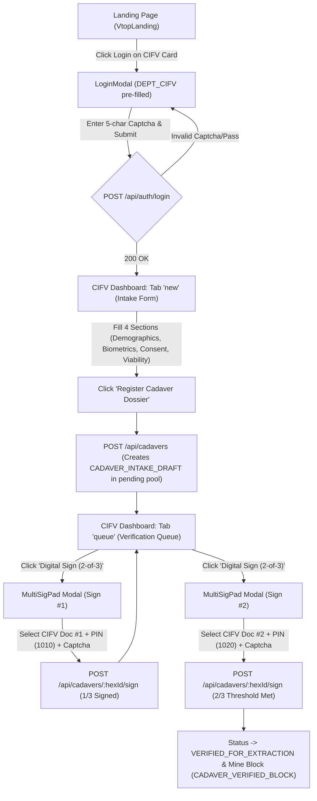
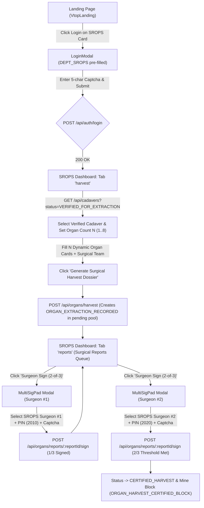
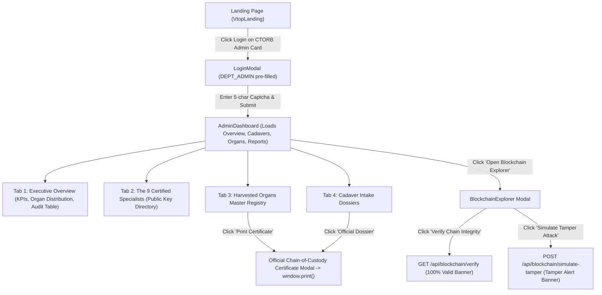
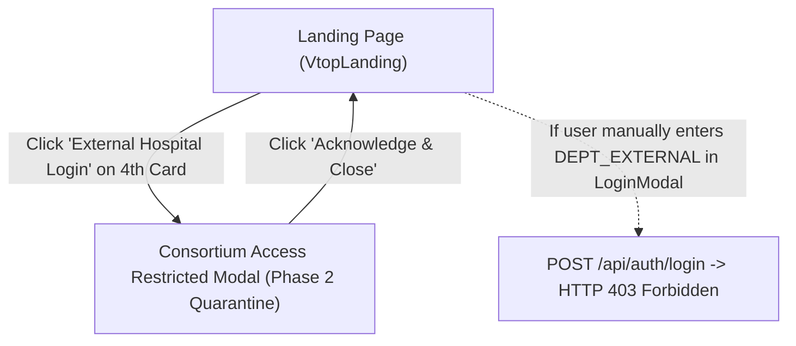
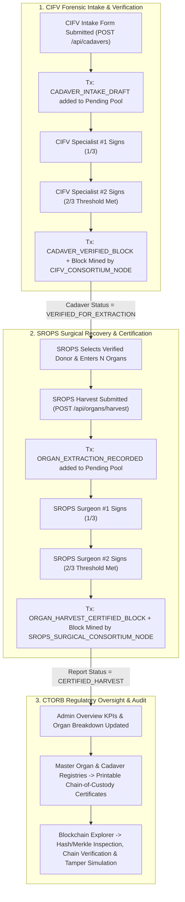

# MediChain UX & System Audit (`PHASE 1` & `PHASE 2`)

> **Scope:** Read-only code audit of `/frontend/src` and `/backend/routes` (+ `/backend/blockchain` and `/backend/data`). No source code was modified during this audit.

---

# PHASE 1 – Current System Map

## 1. Page & Component Inventory

### 1.0 Root Orchestrator: `App.jsx` ([App.jsx](file:///c:/Users/Mayan/OneDrive/Documents/Saranjivi%20paper/Lab%202/Lab%202/frontend/src/App.jsx#L12-L120))
- **Purpose:** Top-level single-page application state container. Controls active department view switching (`VtopLanding`, `CifvDashboard`, `SropsDashboard`, `AdminDashboard`) and global modals (`LoginModal`, `DoctorRosterModal`, `BlockchainExplorer`), while polling blockchain height and the 9-doctor directory every 10 seconds.
- **Props:** None.
- **State:**
  - `currentDept` (`null` | `{ id, name, role, badge, description }`, line 13)
  - `loginModalOpen` (`boolean`, default `false`, line 14)
  - `selectedDeptForLogin` (`object | null`, default `null`, line 15)
  - `doctorModalOpen` (`boolean`, default `false`, line 16)
  - `explorerOpen` (`boolean`, default `false`, line 17)
  - `doctorsList` (`array`, default `[]`, line 18)
  - `blockHeight` (`number`, default `1`, line 19)
- **API Calls:**
  - `fetchBlockchain('ADMIN')` → `GET /api/blockchain` (Header: `x-department-role: ADMIN`) on mount and every 10,000ms (`App.jsx:29-33`). Reads `bRes.blockHeight`.
  - `fetchDoctors()` → `GET /api/auth/doctors` on mount and every 10,000ms (`App.jsx:31-34`). Reads `dRes.doctors`.

---

### 1.1 `VtopLanding.jsx` ([VtopLanding.jsx](file:///c:/Users/Mayan/OneDrive/Documents/Saranjivi%20paper/Lab%202/Lab%202/frontend/src/components/VtopLanding.jsx#L20-L319))
- **Purpose:** Public landing screen inspired by VIT's VTOP portal. Displays 4 department login cards (CIFV, SROPS, CTORB Admin, and restricted External Hospital RTCN), a "Spotlight & Live Bulletins" notice board, simulated Google Play / App Store buttons, a "Distributed Consensus Explorer" card, and the External Hospital restriction modal.
- **Props:**
  - `onSelectDepartment` (`(dept) => void`)
  - `onOpenExplorer` (`() => void`)
  - `onOpenDoctors` (`() => void`)
  - `blockHeight` (`number`)
- **State:**
  - `showExternalWarning` (`boolean`, default `false`, line 21) — toggles the Phase 2 quarantine modal when clicking the 4th card ("External Hospital Login").
- **API Calls:** None directly (invokes parent callbacks).

---

### 1.2 `LoginModal.jsx` ([LoginModal.jsx](file:///c:/Users/Mayan/OneDrive/Documents/Saranjivi%20paper/Lab%202/Lab%202/frontend/src/components/LoginModal.jsx#L6-L203))
- **Purpose:** Department authentication modal with pre-filled demo credentials (`DEPT_CIFV`, `DEPT_SROPS`, `DEPT_ADMIN`), password input, and visual canvas CAPTCHA verification.
- **Props:**
  - `isOpen` (`boolean`)
  - `onClose` (`() => void`)
  - `selectedDept` (`object | null` — passed from `VtopLanding` department card)
  - `onLoginSuccess` (`(department) => void`)
- **State:**
  - `departmentId` (`string`, default `''`, auto-populated from `defaults[selectedDept.role].id`, lines 7, 28)
  - `password` (`string`, default `''`, auto-populated from `defaults[selectedDept.role].pass`, lines 8, 29)
  - `captchaInput` (`string`, default `''`, line 9)
  - `captchaData` (`{ id: string, code: string }`, default `{ id: '', code: '' }`, line 10)
  - `loadingCaptcha` (`boolean`, default `false`, line 11)
  - `submitting` (`boolean`, default `false`, line 12)
  - `error` (`string`, default `''`, line 13)
- **API Calls:**
  1. `fetchCaptcha()` → `GET /api/auth/captcha` (No payload; returns `{ success, captchaId, captchaCode }`, lines 34-46). Triggered when modal opens or when login fails.
  2. `loginDepartment(departmentId, password, captchaData.id, captchaInput)` → `POST /api/auth/login` (Payload: `{ departmentId, password, captchaId, captchaInput }`, lines 67-75). Returns `{ success, department }`.
- **Code Quirk Found:** Line 97 renders `{selectedDept ? selectedDept.name : 'Authorized Consortium Node Access'}`. However, `VtopLanding.jsx:23-73` defines `title` and `subtitle` on each department object, not `name`. As a result, the modal subtitle is blank whenever opened from a department card.

---

### 1.3 `Captcha.jsx` ([Captcha.jsx](file:///c:/Users/Mayan/OneDrive/Documents/Saranjivi%20paper/Lab%202/Lab%202/frontend/src/components/Captcha.jsx#L4-L74))
- **Purpose:** Renders a 5-character alphanumeric security code onto an HTML5 `<canvas>` (`150x42px`) with random noise lines, dots, character rotation, and a refresh button.
- **Props:**
  - `code` (`string` — 5-char code returned in plaintext from `/api/auth/captcha`)
  - `onRefresh` (`() => void`)
  - `loading` (`boolean`, default `false`)
- **State / Refs:**
  - `canvasRef` (`useRef(null)`, line 5)
- **API Calls:** None directly (calls `onRefresh` prop).

---

### 1.4 `Navbar.jsx` ([Navbar.jsx](file:///c:/Users/Mayan/OneDrive/Documents/Saranjivi%20paper/Lab%202/Lab%202/frontend/src/components/Navbar.jsx#L4-L106))
- **Purpose:** Sticky top header displaying the emergency helpline strip, MediChain branding, live `BLOCK HEIGHT #N` button, "The 9 Specialists" directory button, and current signed-in department badge + Logout button.
- **Props:**
  - `currentDept` (`object | null`)
  - `onLogout` (`() => void`)
  - `onOpenDoctors` (`() => void`)
  - `onOpenExplorer` (`() => void`)
  - `blockHeight` (`number`, default `1`)
- **State:** None.
- **API Calls:** None.

---

### 1.5 `DoctorRosterModal.jsx` ([DoctorRosterModal.jsx](file:///c:/Users/Mayan/OneDrive/Documents/Saranjivi%20paper/Lab%202/Lab%202/frontend/src/components/DoctorRosterModal.jsx#L4-L132))
- **Purpose:** Modal displaying the 9 pre-authorized medical & regulatory personnel grouped by department (`CIFV`, `SROPS`, `ADMIN`), including their Medical ID, plaintext default PIN (`1010`–`3030`), role, registration number, hospital, and experience.
- **Props:**
  - `isOpen` (`boolean`)
  - `onClose` (`() => void`)
  - `doctors` (`array`, default `[]`)
- **State:** None.
- **API Calls:** None (receives `doctors` array fetched by `App.jsx`).

---

### 1.6 `MultiSigPad.jsx` ([MultiSigPad.jsx](file:///c:/Users/Mayan/OneDrive/Documents/Saranjivi%20paper/Lab%202/Lab%202/frontend/src/components/MultiSigPad.jsx#L6-L261))
- **Purpose:** Modal dialog used by both CIFV and SROPS to collect 2-out-of-3 specialist digital signatures on a cadaver record or surgical harvest report. Shows current signature count (`X of 3`), progress bar, already-signed doctors, specialist dropdown, PIN input (with plaintext hint of the selected doctor's default PIN), and CAPTCHA.
- **Props:**
  - `isOpen` (`boolean`)
  - `onClose` (`() => void`)
  - `department` (`string`, default `'CIFV'` — `'CIFV'` or `'SROPS'`)
  - `recordId` (`string` — `hexId` or `reportId`)
  - `recordTitle` (`string`)
  - `existingSignatures` (`array`, default `[]`)
  - `onSignSubmit` (`async ({ doctorId, pin, captchaId, captchaInput }) => void`)
- **State:**
  - `doctors` (`array`, default `[]`, line 15)
  - `selectedDoctorId` (`string`, default `''`, line 16)
  - `pin` (`string`, default `''`, line 17)
  - `captchaInput` (`string`, default `''`, line 18)
  - `captchaData` (`{ id: '', code: '' }`, line 19)
  - `loadingCaptcha` (`boolean`, default `false`, line 20)
  - `submitting` (`boolean`, default `false`, line 21)
  - `error` (`string`, default `''`, line 22)
- **API Calls:**
  1. `fetchDoctors(department)` → `GET /api/auth/doctors?department=${department}` (`MultiSigPad.jsx:36`). Auto-selects the first doctor who has not yet signed (`lines 41-42`).
  2. `fetchCaptcha()` → `GET /api/auth/captcha` (`MultiSigPad.jsx:53`).
  3. Delegates actual signature submission to `onSignSubmit` prop (`MultiSigPad.jsx:86-91`).
- **Code Quirk Found:** `MultiSigPad` requires the user to solve a CAPTCHA (`lines 79-82`) and passes `captchaId` and `captchaInput` to `onSignSubmit`, but neither `CifvDashboard.jsx:157` nor `SropsDashboard.jsx:198` forwards `captchaId`/`captchaInput` to the backend, and `/api/cadavers/:hexId/sign` and `/api/organs/reports/:reportId/sign` do not check CAPTCHA at all! Meanwhile `verifyDoctor()` in `api.js:23-30` (`POST /api/auth/verify-doctor`) is dead code and never called.

---

### 1.7 `CifvDashboard.jsx` ([CifvDashboard.jsx](file:///c:/Users/Mayan/OneDrive/Documents/Saranjivi%20paper/Lab%202/Lab%202/frontend/src/components/CifvDashboard.jsx#L23-L1006))
- **Purpose:** Portal for the **Cadaveric Intake & Forensic Verification Wing (CIFV)**. Contains two tabs:
  - Tab 1 (`'new'`): Single-page 4-section Cadaver Intake Form with demographics, death/arrival chronology, physical traits, base64 image uploads for face/fingerprint/retina with conditional damage checkboxes, family NOK vs. police inquest toggle, and clinical viability/infection screening.
  - Tab 2 (`'queue'`): Grid of registered cadaver cards showing signature progress (`X of 3`) and a button to launch `MultiSigPad`.
- **Props:**
  - `onOpenExplorer` (`() => void` — passed from `App.jsx` but **unused** inside `CifvDashboard`)
  - `onOpenDoctors` (`() => void` — passed from `App.jsx` but **unused** inside `CifvDashboard`)
- **State:**
  - `activeTab` (`'new' | 'queue'`, default `'new'`, line 24)
  - `cadavers` (`array`, default `[]`, line 25)
  - `loading` (`boolean`, default `false`, line 26)
  - `submitting` (`boolean`, default `false`, line 27)
  - `message` (`{ type: 'success' | 'error', text: string } | null`, default `null`, line 28)
  - `signingModalOpen` (`boolean`, default `false`, line 31)
  - `selectedRecordForSign` (`object | null`, default `null`, line 32)
  - `previewHexId` (`string`, default `''`, line 35)
  - `formData` (`object` with 31 properties, lines 38-82)
- **API Calls:**
  1. `fetchCadavers()` → `GET /api/cadavers` (`CifvDashboard.jsx:101`). Returns `{ success, count, cadavers }`.
  2. `submitCadaver({ ...formData, submittedBy: 'CIFV_REGISTRATION_DESK' })` → `POST /api/cadavers` (`CifvDashboard.jsx:134-137`). Sends all 31 `formData` fields plus `submittedBy`.
  3. `signCadaver(selectedRecordForSign.hexId, doctorId, pin)` → `POST /api/cadavers/:hexId/sign` (`CifvDashboard.jsx:159`). Payload: `{ doctorId, pin }`.
- **Code Quirks Found:**
  - **Fake Preview Hex ID:** `generateLiveHexPreview()` (`lines 89-96`) generates a client-side random hex string (e.g. `0x7A92C4E1`) displayed in a large banner (`lines 248-263`), but `previewHexId` is never sent to the backend. `POST /api/cadavers` generates a brand new `hexId` on the server (`cadaverRoutes.js:93`), so the saved record has a different Hex ID than what the user saw on the form!
  - **5 Unrendered Form State Fields:** `formData` defines `otherMedicalTerms` (line 48), `nokConsentSignature` (line 70), `nokThumbprint` (line 71), `verifyingDoctorsCount` (line 75), and `diseaseChecklist` (line 80), which have **no input controls** in the JSX and are only submitted as static default values.
  - **Form Not Reset After Submission:** `handleSubmitIntake` (`lines 124-155`) switches to the `'queue'` tab on success without resetting `formData`.

---

### 1.8 `SropsDashboard.jsx` ([SropsDashboard.jsx](file:///c:/Users/Mayan/OneDrive/Documents/Saranjivi%20paper/Lab%202/Lab%202/frontend/src/components/SropsDashboard.jsx#L34-L768))
- **Purpose:** Portal for the **Surgical Retrieval & Organ Preservation Suite (SROPS)**. Contains two tabs:
  - Tab 1 (`'harvest'`): Dynamic Organ Harvest Form. Selects a `VERIFIED_FOR_EXTRACTION` cadaver, sets arrival date/time and `totalOrgans` ($N \in [1..8]$), dynamically generates $N$ organ specification cards with algorithmic Organ ID preview (`[Last4Hex]-[OrganCode]-[4Random]`), and records surgical team notes.
  - Tab 2 (`'reports'`): Surgical Reports Queue showing harvested organs per report and a button to open `MultiSigPad` for 2-of-3 surgeon certification.
- **Props:**
  - `onOpenExplorer` (`() => void` — **unused** inside `SropsDashboard`)
  - `onOpenDoctors` (`() => void` — **unused** inside `SropsDashboard`)
- **State:**
  - `activeTab` (`'harvest' | 'reports'`, default `'harvest'`, line 35)
  - `verifiedCadavers` (`array`, default `[]`, line 36)
  - `reports` (`array`, default `[]`, line 37)
  - `loading` (`boolean`, default `false`, line 38)
  - `submitting` (`boolean`, default `false`, line 39)
  - `message` (`{ type, text } | null`, default `null`, line 40)
  - `signingModalOpen` (`boolean`, default `false`, line 43)
  - `selectedReportForSign` (`object | null`, default `null`, line 44)
  - `selectedCadaver` (`object | null`, default `null`, line 47)
  - `totalOrgans` (`number`, default `3`, line 50)
  - `organsList` (`array` of $N$ organ slot objects, default `[]`, line 51)
  - `arrivalDate` (`string`, default today's ISO date, line 54)
  - `arrivalTime` (`string`, default `'11:00'`, line 55)
  - `surgeonsCount` (`number`, default `3`, line 56)
  - `surgeonsList` (`string`, default `'Dr. Sunil Kulkarni (SROPS-SUR-201), Dr. Neha Deshmukh (SROPS-SUR-202)'`, lines 57-59)
  - `surgicalNotes` (`string`, default `'Cold perfusion established with UW Solution at 4°C.'`, line 60)
- **API Calls:**
  1. `fetchCadavers('VERIFIED_FOR_EXTRACTION')` → `GET /api/cadavers?status=VERIFIED_FOR_EXTRACTION` (`SropsDashboard.jsx:75`).
  2. `fetchHarvestReports()` → `GET /api/organs/reports` (`SropsDashboard.jsx:84`).
  3. `submitOrganHarvest(payload)` → `POST /api/organs/harvest` (`SropsDashboard.jsx:168-179`). Payload: `{ cadaverHexId, patientName, arrivalDateAtExtraction, arrivalTimeAtExtraction, totalOrgansExtracted, organs, operatingSurgeonsCount, operatingSurgeonsList, notes, submittedBy: 'SROPS_CHIEF_SURGEON' }`.
  4. `signOrganHarvest(selectedReportForSign.reportId, doctorId, pin)` → `POST /api/organs/reports/:reportId/sign` (`SropsDashboard.jsx:200`). Payload: `{ doctorId, pin }`.
- **Code Quirks Found:**
  - **Organ ID Mismatch Between Preview and Saved Record:** `computeOrganId` (`lines 99-105`) generates a 4-digit random suffix in the UI (e.g., `7A92-01-4821`), but `POST /api/organs/harvest` (`organRoutes.js:131`) ignores `org.organId` from the request body and calls `generateOrganId()` again on the backend, producing a different 4-digit random suffix!
  - **Destructive Organ Slot Rebuild:** `useEffect` (`lines 67-69`) calls `buildDynamicOrganSlots(totalOrgans, selectedCadaver)` whenever `totalOrgans` changes, completely wiping any custom edits or uploaded QA photos on existing organ cards (`lines 107-128`).
  - **Per-Organ `qaNotes` Field Never Rendered:** Each slot in `organsList` has `qaNotes` initialized (`line 124`), but there is no input in the card JSX to view or edit `qaNotes`.

---

### 1.9 `AdminDashboard.jsx` ([AdminDashboard.jsx](file:///c:/Users/Mayan/OneDrive/Documents/Saranjivi%20paper/Lab%202/Lab%202/frontend/src/components/AdminDashboard.jsx#L23-L604))
- **Purpose:** Portal for the **Central Transplant Oversight Regulatory Board (CTORB - Admin)**. Contains 4 tabs:
  - `'overview'`: 4 KPI cards, Organ Distribution Breakdown grid, static Cold Ischemia Viability Limits card, and Recent Blockchain Consortium Audit Trail table (top 6 logs).
  - `'personnel'`: Cards for all 9 certified specialists with public keys.
  - `'organs'`: Master registry of all harvested organs (including uncertified ones!) with a "Print Certificate" modal trigger.
  - `'cadavers'`: List of all cadaver intake dossiers with an "Official Dossier" print modal trigger.
- **Props:**
  - `onOpenExplorer` (`() => void`)
  - `onOpenDoctors` (`() => void` — **unused** inside `AdminDashboard`)
- **State:**
  - `activeTab` (`'overview' | 'personnel' | 'organs' | 'cadavers'`, default `'overview'`, line 24)
  - `adminData` (`object | null`, default `null`, line 25)
  - `cadavers` (`array`, default `[]`, line 26)
  - `organs` (`array`, default `[]`, line 27)
  - `harvestReports` (`array`, default `[]`, line 28 — **fetched but never used in JSX**)
  - `loading` (`boolean`, default `true`, line 29 — **set but never rendered in JSX**)
  - `searchQuery` (`string`, default `''`, line 30 — **declared but never used/rendered in JSX**)
  - `selectedItemForCert` (`object | null`, default `null`, line 33)
- **API Calls:**
  1. `fetchAdminOverview()` → `GET /api/admin/overview` (`AdminDashboard.jsx:43`)
  2. `fetchCadavers()` → `GET /api/cadavers` (`AdminDashboard.jsx:44`)
  3. `fetchOrgansList()` → `GET /api/organs/list` (`AdminDashboard.jsx:45`)
  4. `fetchHarvestReports()` → `GET /api/organs/reports` (`AdminDashboard.jsx:46`)
- **Code Quirks Found:**
  - **KPI Discrepancy on Initial Load:** `/api/admin/overview` (`adminRoutes.js:25-57`) calculates `totalIntakes`, `totalVerified`, `totalHarvests`, and `organDistribution` by iterating only over `ledger.chain` blocks. However, the pre-seeded sample cadaver (`0x4F8B7A92` in `cadaverRoutes.js:12-80`) and pre-seeded harvest report (`HARVEST_0X4F8B7A92` in `organRoutes.js:23-99`) exist in memory and in `ledger.json` depending on state, while new drafts (`CADAVER_INTAKE_DRAFT`, `ORGAN_EXTRACTION_RECORDED`) stay in `ledger.pendingTransactions` until a 2-of-3 block is mined. Thus `totalIntakes` in Admin Overview remains `0` until a block is mined, even when unverified cadavers exist in the Cadaver Dossiers tab!
  - **Certificate Modal Falsely Claims Unverified Records are Mined On-Chain:** In `AdminDashboard.jsx:571-573`, the certificate modal hardcodes `CONSORTIUM VERIFIED (MINED ON-CHAIN)` even if the user clicked "Official Dossier" on a cadaver whose status is `PENDING_INSPECTION_SIGNATURES` or an organ whose status is `PENDING_SURGICAL_SIGNATURES`.

---

### 1.10 `BlockchainExplorer.jsx` ([BlockchainExplorer.jsx](file:///c:/Users/Mayan/OneDrive/Documents/Saranjivi%20paper/Lab%202/Lab%202/frontend/src/components/BlockchainExplorer.jsx#L19-L378))
- **Purpose:** Full-screen dark-themed modal for inspecting the blockchain (`ledger.chain`), searching blocks/transactions, verifying cryptographic chain integrity, and running a live tamper-attack simulation.
- **Props:**
  - `isOpen` (`boolean`)
  - `onClose` (`() => void`)
- **State:**
  - `chainData` (`{ chain: array, blockHeight: number }`, default `{ chain: [], blockHeight: 0 }`, line 20)
  - `loading` (`boolean`, default `true`, line 21)
  - `verifying` (`boolean`, default `false`, line 22)
  - `verificationResult` (`object | null`, default `null`, line 23)
  - `tamperResult` (`object | null`, default `null`, line 24)
  - `searchQuery` (`string`, default `''`, line 25)
  - `selectedBlock` (`object | null`, default `null`, line 26)
- **API Calls:**
  1. `fetchBlockchain('ADMIN')` → `GET /api/blockchain` (Header: `x-department-role: ADMIN`, line 39).
  2. `verifyBlockchainIntegrity()` → `GET /api/blockchain/verify` (line 56).
  3. `simulateTamper()` → `POST /api/blockchain/simulate-tamper` (line 67). Mutates `ledger.chain[1].transactions[0].payload` in memory, runs `isChainValid()`, then immediately restores from `ledger.json` via `ledger.init()` (`blockchainRoutes.js:67-78`) and returns the diagnostic error string.

---

## 2. Step-by-Step User Flows by Role

### 2.1 Role 1: CIFV Officer (`DEPT_CIFV` – Cadaveric Intake & Forensic Verification Wing)
1. **Landing Screen (`VtopLanding.jsx`):**
   - User views the 4 department cards and clicks **"Login →"** on the **Cadaveric Intake Wing (`CIFV`)** card (`VtopLanding.jsx:157`).
2. **Department Login (`LoginModal.jsx`):**
   - Modal opens; `departmentId` (`DEPT_CIFV`) and `password` (`Pass@cifv2026`) are pre-filled automatically (`LoginModal.jsx:27-30`).
   - `GET /api/auth/captcha` fetches a 5-character code rendered onto `<Captcha />`.
   - User types the 5-character CAPTCHA into the input (`LoginModal.jsx:172-179`) and clicks **"Authenticate to Department Node"** (`LoginModal.jsx:184`).
   - `POST /api/auth/login` validates CAPTCHA and credentials; `App.jsx` sets `currentDept` to CIFV and mounts `<CifvDashboard />`.
3. **Cadaver Intake Form (`CifvDashboard.jsx` – Tab `'new'`):**
   - User sees an autogenerated preview Hex ID banner (e.g., `0x7A92C4E1`).
   - **Section 1 (Demographics & Chronology):**
     - Enters *Name of Deceased Body* (`patientName`, required), *Estimated / Confirmed Age* (`age`, required), selects *Biological Sex* (`gender`, defaults to `'Male'`), and *Blood Group* (`bloodGroup`, defaults to `'O+'`).
     - Reviews/edits pre-filled *Date of Death* (`deathDate`), *Time of Death* (`deathTime`, `'08:30'`), *Arrival Date at CIFV* (`arrivalDate`), and *Arrival Time at CIFV* (`arrivalTime`, `'09:15'`).
     - Enters *Certified Cause of Death* (`causeOfDeath`, required), *Condition of the Body* (`bodyCondition`, pre-filled `'Intact - Non-decomposed'`), *Hair Colour* (`'Black'`), *Skin Colour / Complexion* (`'Wheatish'`), and *Unique Identification Marks* (`'Mole on right cheek'`).
   - **Section 2 (Forensic Biometric Verification):**
     - Optionally uploads *Facial Portrait Image* (`faceImage`, converted to base64 Data URL via `FileReader`).
     - For *Fingerprint Record*: either uploads `fingerprintImage` OR checks *"Fingers Severed / Burned / Damaged"* (`fingerprintDamaged`), which swaps the file uploader for a mandatory-labeled textarea (`fingerprintDamageDetails`).
     - For *Eyes & Retina Record*: either uploads `retinaImage` OR checks *"Eyes / Cornea Traumatized / Damaged"* (`retinaDamaged`), which swaps the file uploader for a textarea (`retinaDamageDetails`).
   - **Section 3 (Family Approval & Legal Authorization):**
     - Selects radio *"Yes (Family Consent)"* (`hasFamily = true`) to fill *Next of Kin Full Name* (`nokName`), *Relationship* (`nokRelation`, `'Spouse'`), and *Contact Phone Number* (`nokContact`); OR selects *"No (Unclaimed / Police Inquest Handover)"* (`hasFamily = false`) to fill *How was the Body Received?* (`unclaimedDetails`).
   - **Section 4 (Clinical Viability & Infectious Screening):**
     - Selects radio for *Clinically Appropriate for Organ Harvesting* (`isAppropriateForHarvesting`, defaults to `true`) and edits notes (`harvestAppropriatenessNotes`).
     - Selects radio for *Infectious Disease Contamination Status* (`isContaminatedDisease`, defaults to `false`).
     - Reviews/edits pre-filled *Verifying Medical Officers* (`verifyingDoctorNames`, required) and *Other Clinical / Forensic Observations* (`additionalObservations`).
   - Clicks **"Register Cadaver Dossier & Generate Record"** (`CifvDashboard.jsx:835`).
   - `POST /api/cadavers` creates the record with status `PENDING_INSPECTION_SIGNATURES`, assigns server-generated `hexId`, appends a `CADAVER_INTAKE_DRAFT` transaction to `ledger.pendingTransactions`, and saves `ledger.json`.
4. **Verification Queue & 2-of-3 Multi-Signature (`CifvDashboard.jsx` – Tab `'queue'` & `MultiSigPad.jsx`):**
   - View automatically switches to `activeTab = 'queue'` (`CifvDashboard.jsx:145`).
   - User locates the new cadaver card (showing `0 of 3` signatures and amber badge `PENDING 2-OF-3 SIGNATURES`) and clicks **"Digital Sign (2-of-3)"** (`CifvDashboard.jsx:962`).
   - **Signature 1:** `MultiSigPad` opens (`department="CIFV"`). `GET /api/auth/doctors?department=CIFV` loads the 3 CIFV doctors and auto-selects `Dr. Rajesh Sharma (CIFV-DOC-101)`. User sees hint `Default PIN: 1010`, types `1010` in the PIN field, types the 5-char CAPTCHA code, and clicks **"Apply Digital Signature & Broadcast"**.
   - `POST /api/cadavers/:hexId/sign` verifies PIN, appends HMAC-SHA256 signature #1 (`1 of 3`), and closes the modal. Status remains `PENDING_INSPECTION_SIGNATURES`.
   - **Signature 2:** User clicks **"Digital Sign (2-of-3)"** on the same card again. `MultiSigPad` opens and auto-selects the next unsigned doctor, `Dr. Ananya Iyer (CIFV-DOC-102)`. User enters PIN `1020`, enters the new CAPTCHA code, and clicks **"Apply Digital Signature & Broadcast"**.
   - `POST /api/cadavers/:hexId/sign` appends signature #2 (`2 of 3`). Because `cadaver.signatures.length >= 2`, the backend transitions `cadaver.status` to `'VERIFIED_FOR_EXTRACTION'`, creates a `CADAVER_VERIFIED_BLOCK` transaction, and calls `ledger.minePendingTransactions('CIFV_CONSORTIUM_NODE')`, mining a new Proof-of-Authority block containing both `CADAVER_INTAKE_DRAFT` and `CADAVER_VERIFIED_BLOCK`!
   - The card badge updates to green `VERIFIED (MINED)` and shows `Cleared for SROPS`.

---

### 2.2 Role 2: SROPS Surgeon (`DEPT_SROPS` – Surgical Retrieval & Organ Preservation Suite)
1. **Login (`VtopLanding.jsx` → `LoginModal.jsx`):**
   - Clicks **"Logout"** in `Navbar` (if logged in as CIFV), then clicks **"Login →"** on the **Surgical Retrieval Suite (`SROPS`)** card (`VtopLanding.jsx:157`).
   - `LoginModal` auto-fills `DEPT_SROPS` and `Pass@srops2026`. User enters the 5-character CAPTCHA and clicks **"Authenticate to Department Node"**.
2. **Dynamic Organ Harvest Form (`SropsDashboard.jsx` – Tab `'harvest'`):**
   - On mount, `GET /api/cadavers?status=VERIFIED_FOR_EXTRACTION` loads verified cadavers and auto-selects the first one (`SropsDashboard.jsx:75-80`).
   - **Step 1 (Donor & Cadaver Selection):**
     - Selects donor from *Select Verified Cadaver* dropdown (or keeps default). *Donor Name* and *Cadaver Unique Hex ID* are shown in disabled inputs.
     - Reviews/edits *Arrival Date at Surgical Suite* (`arrivalDate`), *Arrival Time at Surgical Suite* (`arrivalTime`, `'11:00'`), and selects *Total Number of Organs Extracted (N)* (`totalOrgans` dropdown `1`–`8`, defaults to `3`).
   - **Step 2 (Dynamic Harvested Organ Slots):**
     - $N$ organ cards are rendered (`organsList`). For each organ slot `#1..#N`:
       - Selects *Organ Name / Category* (`Heart`, `Eye / Cornea`, `Liver`, `Left Kidney`, `Right Kidney`, `Lung`, `Pancreas`, `Small Bowel / Intestine`). Changing this updates the preview badge `[Last4Hex]-[Code]-[4Random]`.
       - Selects *Organ Viability / Condition* (`Grade A`, `Grade B`, or `Under Evaluation`).
       - Reviews/edits *Harvest / Cross-Clamp Date* (`extractionDate`), *Cross-Clamp Timestamp* (`extractionTime`, `'11:45'`), *Preservation Solution* (`'University of Wisconsin (UW) Solution'`), and *Storage Temperature* (`'4°C (Static Cold Storage)'`).
       - Optionally uploads a *QA Specimen Photo* (`qaImage`).
   - **Step 3 (Operating Retrieval Surgical Team):**
     - Reviews/edits *Number of Surgeons / Specialists* (`surgeonsCount`, default `3`), *Operating Surgeons Names & Medical Registration IDs* (`surgeonsList`, required), and *Post-Harvest Surgical Notes* (`surgicalNotes`).
   - Clicks **"Generate Surgical Harvest Dossier"** (`SropsDashboard.jsx:608`).
   - `POST /api/organs/harvest` creates a harvest report with status `PENDING_SURGICAL_SIGNATURES`, generates final Organ IDs, adds an `ORGAN_EXTRACTION_RECORDED` transaction to `ledger.pendingTransactions`, and switches to `activeTab = 'reports'`.
3. **Surgical Reports Queue & 2-of-3 Surgeon Signatures (`SropsDashboard.jsx` – Tab `'reports'` & `MultiSigPad.jsx`):**
   - User finds the new report card (status `PENDING 2-OF-3 SURGEON SIGNATURES`, `0 of 3`) and clicks **"Surgeon Sign (2-of-3)"** (`SropsDashboard.jsx:725`).
   - **Signature 1:** `MultiSigPad` opens (`department="SROPS"`). Auto-selects `Dr. Sunil Kulkarni (SROPS-SUR-201)`. User enters PIN `2010` + CAPTCHA and submits. `POST /api/organs/reports/:reportId/sign` records signature #1 (`1 of 3`).
   - **Signature 2:** User clicks **"Surgeon Sign (2-of-3)"** again. `MultiSigPad` auto-selects `Dr. Neha Deshmukh (SROPS-SUR-202)`. User enters PIN `2020` + CAPTCHA and submits.
   - `POST /api/organs/reports/:reportId/sign` records signature #2 (`2 of 3`), transitions `report.status` to `'CERTIFIED_HARVEST'`, creates an `ORGAN_HARVEST_CERTIFIED_BLOCK` transaction, and mines a new block via `ledger.minePendingTransactions('SROPS_SURGICAL_CONSORTIUM_NODE')`.
   - Report badge updates to `CERTIFIED & MINED` and shows `Dispatched to Admin Portal`.

---

### 2.3 Role 3: CTORB Admin (`DEPT_ADMIN` – Central Transplant Oversight Regulatory Board)
1. **Login (`VtopLanding.jsx` → `LoginModal.jsx`):**
   - Clicks **"Login →"** on the **Central Regulatory Board (`CTORB`)** card.
   - `LoginModal` pre-fills `DEPT_ADMIN` / `Pass@admin2026`. User enters CAPTCHA and submits.
2. **Executive Overview (`AdminDashboard.jsx` – Tab `'overview'`):**
   - Parallel API calls load `/api/admin/overview`, `/api/cadavers`, `/api/organs/list`, and `/api/organs/reports`.
   - Views 4 KPI cards (*Total Donors Registered*, *Total Organs Harvested*, *Consortium Block Height*, *Certified Personnel*), *Organ Distribution Breakdown*, *Cold Ischemia Viability Limits*, and *Recent Blockchain Consortium Audit Trail*.
3. **The 9 Certified Specialists (`AdminDashboard.jsx` – Tab `'personnel'`):**
   - Clicks tab **"The 9 Certified Specialists (9)"** (`AdminDashboard.jsx:120`) to inspect all 9 doctors, their MCI registration numbers, hospitals, and public keys.
4. **Harvested Organs Master Registry & Certificate Printing (`AdminDashboard.jsx` – Tab `'organs'`):**
   - Clicks tab **"Harvested Organs Master Registry"** (`AdminDashboard.jsx:130`) to inspect individual organ cards.
   - Clicks **"Print Certificate"** (`AdminDashboard.jsx:460`) on any organ card to open the *Certificate of Cadaveric Organ Chain-of-Custody* modal, then clicks **"Print Official Certificate"** (`window.print()`, line 592) or **"Close"**.
5. **Cadaver Intake Dossiers (`AdminDashboard.jsx` – Tab `'cadavers'`):**
   - Clicks tab **"Cadaver Intake Dossiers"** (`AdminDashboard.jsx:140`) to inspect donor cards and click **"Official Dossier"** (`line 517`) to open the printable certificate modal.
6. **Blockchain Explorer & Tamper Audit (`BlockchainExplorer.jsx`):**
   - Clicks **"Open Blockchain Explorer"** (`AdminDashboard.jsx:98` or `Navbar.jsx:57`).
   - Selects blocks in the left column to inspect SHA-256 hashes, previous hashes, Merkle roots, nonces, transaction JSON payloads, and 2-of-3 HMAC signatures on the right.
   - Uses the search bar (`BlockchainExplorer.jsx:182`) to filter blocks by hash, index, or payload content.
   - Clicks **"Verify Chain Integrity"** (`line 115` → `GET /api/blockchain/verify`) to confirm all blocks are valid.
   - Clicks **"Simulate Tamper Attack"** (`line 125` → `POST /api/blockchain/simulate-tamper`) to trigger an amber diagnostic alert demonstrating instant hash mismatch detection.

---

### 2.4 Role 4: External Hospital (`DEPT_EXTERNAL` / `RTCN` – Recipient Transplant Center Network)
1. **UI Path (`VtopLanding.jsx`):**
   - On the landing page, the 4th card (**Recipient Hospital Network / `RTCN`**) has `isRestricted: true` (`VtopLanding.jsx:71`).
   - Clicking **"External Hospital Login"** (`line 148`) does **not** open `LoginModal`; instead it sets `showExternalWarning = true` and opens a modal titled **"Consortium Access Restricted"** explaining that external hospitals are isolated in Phase 2 (`lines 282-309`).
   - User clicks **"Acknowledge & Close"** (`line 302`) to dismiss.
2. **Direct API / Manual Credential Path (`authRoutes.js` & `blockchainRoutes.js`):**
   - If a user opens `LoginModal` via another card and manually types `DEPT_EXTERNAL` with a valid CAPTCHA, `POST /api/auth/login` returns HTTP `403 Forbidden` with `"External Recipient Hospital access is restricted under Phase 2 consortium security guidelines."` (`authRoutes.js:59-65`).
   - Any call to `/api/blockchain` with header `x-department-role: EXTERNAL` (or `EXTERNAL_HOSPITAL` or `RTCN`) returns HTTP `403 Forbidden` (`CONSORTIUM_ACCESS_DENIED`, `blockchainRoutes.js:16-22`).

---

## 3. Mermaid Flowcharts

### 3.1 CIFV Officer Role Flowchart

### 3.2 SROPS Surgeon Role Flowchart

### 3.3 CTORB Admin Role Flowchart

### 3.4 External Hospital (`RTCN`) Role Flowchart

### 3.5 End-to-End Consortium Lifecycle Flowchart

---

## 4. Complete Table of Every Form & Field

### 4.1 Form 1: Department Login (`LoginModal.jsx`)
| Field Name | UI Label | Input Type | Required / Optional | Client & Server Validation | Where Stored |
| :--- | :--- | :--- | :--- | :--- | :--- |
| `departmentId` | Department Medical ID | `text` | Required | Client: `!departmentId.trim()` (`LoginModal.jsx:52`). Server: case-insensitive match against `CONSORTIUM_CREDENTIALS.departments` (`authRoutes.js:49`); blocks `EXTERNAL` with `403`. | Transient (`App.jsx` `currentDept` React state only; lost on page refresh). |
| `password` | Department Access Password | `password` | Required | Client: `!password` (`LoginModal.jsx:56`). Server: exact match `matchedDept.password !== password` (`authRoutes.js:67`). | Not stored after authentication check. |
| `captchaInput` | Security Captcha Verification | `text` (`maxLength=6`) | Required | Client: `!captchaInput.trim()` (`LoginModal.jsx:60`). Server: 5-min TTL in `captchaStore` Map + case-insensitive match (`authRoutes.js:35-43`), one-time use. | `captchaStore` in-memory `Map` (`authRoutes.js:7`), deleted upon check. |

---

### 4.2 Form 2: New Cadaver Intake Form (`CifvDashboard.jsx`)
| Field Name | UI Label | Input Type | Required / Optional | Validation | Where Stored |
| :--- | :--- | :--- | :--- | :--- | :--- |
| `patientName` | Name of Deceased Body * | `text` | Required | HTML `required` (`line 279`) + JS `alert()` if `!formData.patientName.trim()` (`line 126`). Server fallback: `'Unidentified Doe'` (`cadaverRoutes.js:97`). | `cadaverRegistry` in-memory array (`cadaverRoutes.js:12`) + `CADAVER_INTAKE_DRAFT` & `CADAVER_VERIFIED_BLOCK` tx payload in `backend/data/ledger.json`. |
| `age` | Estimated / Confirmed Age * | `number` | Required | HTML `required` (`line 293`). No min/max range validation (accepts negative or `999`). | `cadaverRegistry` in-memory array (`cadaverRoutes.js:98`). |
| `gender` | Biological Sex * | `select` | Required (default `'Male'`) | Restricted to options `Male`, `Female`, `Other`. | `cadaverRegistry` in-memory array (`cadaverRoutes.js:99`). |
| `bloodGroup` | Blood Group * | `select` | Required (default `'O+'`) | Restricted to `A+`, `A-`, `B+`, `B-`, `AB+`, `AB-`, `O+`, `O-`. | `cadaverRegistry` + `ledger.json` tx payload (`cadaverRoutes.js:121, 170`). |
| `deathDate` | Date of Death * | `date` | Required (default today) | HTML `required` (`line 339`). No chronological check against `arrivalDate`. | `cadaverRegistry` + hashed into `blockchainHash` (`cadaverRoutes.js:102, 159`). |
| `deathTime` | Time of Death (24h) * | `time` | Required (default `'08:30'`) | HTML `required` (`line 352`). | `cadaverRegistry` in-memory array (`cadaverRoutes.js:103`). |
| `arrivalDate` | Arrival Date at CIFV * | `date` | Required (default today) | HTML `required` (`line 365`). | `cadaverRegistry` in-memory array (`cadaverRoutes.js:104`). |
| `arrivalTime` | Arrival Time at CIFV * | `time` | Required (default `'09:15'`) | HTML `required` (`line 378`). | `cadaverRegistry` in-memory array (`cadaverRoutes.js:105`). |
| `causeOfDeath` | Certified Cause of Death * | `text` | Required | HTML `required` (`line 393`). | `cadaverRegistry` + `ledger.json` tx payload (`cadaverRoutes.js:100, 171`). |
| `bodyCondition` | Condition of the Body | `text` | Optional (default `'Intact - Non-decomposed'`) | None. | `cadaverRegistry` in-memory array (`cadaverRoutes.js:101`). |
| `hairColor` | Hair Colour | `text` | Optional (default `'Black'`) | None. | `cadaverRegistry` in-memory array (`cadaverRoutes.js:122`). |
| `skinColor` | Skin Colour / Complexion | `text` | Optional (default `'Wheatish'`) | None. | `cadaverRegistry` in-memory array (`cadaverRoutes.js:123`). |
| `identificationMarks` | Unique Identification Marks | `text` | Optional (default `'Mole on right cheek'`) | None (Server fallback `'NA'`). | `cadaverRegistry` in-memory array (`cadaverRoutes.js:124`). |
| `faceImage` | Facial Portrait Image * | `file` (`image/*`) | Optional in code (despite `*` in label!) | No `required` attribute or JS check (`line 493`). Converted to base64 Data URL. | `cadaverRegistry[].faceImage` in memory (`cadaverRoutes.js:109`). |
| `fingerprintDamaged` | Fingers Severed / Burned / Damaged | `checkbox` | Optional (default `false`) | Boolean toggle between file upload and damage textarea. | `cadaverRegistry[].fingerprint.isDamaged` (`cadaverRoutes.js:111`). |
| `fingerprintDamageDetails` | Reason / Extent of Damage (Mandatory): | `textarea` | Optional in code (despite "Mandatory" label!) | Shown when `fingerprintDamaged === true` (`line 532`), but lacks `required` attribute or JS check. | `cadaverRegistry[].fingerprint.damageDetails` (`cadaverRoutes.js:112`). |
| `fingerprintImage` | Upload Fingerprint | `file` (`image/*`) | Optional | Shown when `fingerprintDamaged === false`. Base64 Data URL. | `cadaverRegistry[].fingerprint.image` (`cadaverRoutes.js:113`). |
| `retinaDamaged` | Eyes / Cornea Traumatized / Damaged | `checkbox` | Optional (default `false`) | Boolean toggle between file upload and damage textarea. | `cadaverRegistry[].retina.isDamaged` (`cadaverRoutes.js:116`). |
| `retinaDamageDetails` | Reason / Ocular Damage Details: | `textarea` | Optional | Shown when `retinaDamaged === true` (`line 602`), no `required` attribute. | `cadaverRegistry[].retina.damageDetails` (`cadaverRoutes.js:117`). |
| `retinaImage` | Upload Retinal Photo | `file` (`image/*`) | Optional | Shown when `retinaDamaged === false`. Base64 Data URL. | `cadaverRegistry[].retina.image` (`cadaverRoutes.js:118`). |
| `hasFamily` | Next of Kin / Family Present? | `radio` | Required (default `true`) | Boolean toggle between NOK fields and unclaimed inquest textarea. | `cadaverRegistry[].familyConsent.hasFamily` (`cadaverRoutes.js:129`). |
| `nokName` | Next of Kin Full Name * | `text` | Optional in code (despite `*` in label!) | Shown when `hasFamily === true` (`line 681`), but has **no** `required` attribute or JS check. | `cadaverRegistry[].familyConsent.nokName` (`cadaverRoutes.js:130`). |
| `nokRelation` | Relationship with Deceased | `text` | Optional (default `'Spouse'`) | Shown when `hasFamily === true`. | `cadaverRegistry[].familyConsent.nokRelation` (`cadaverRoutes.js:131`). |
| `nokContact` | Contact Phone Number | `text` | Optional | Shown when `hasFamily === true`. No phone format check. | `cadaverRegistry[].familyConsent.nokContact` (`cadaverRoutes.js:132`). |
| `unclaimedDetails` | How was the Body Received? | `textarea` | Optional in code (despite "Mandatory" in label!) | Shown when `hasFamily === false` (`line 721`), no `required` attribute. | `cadaverRegistry[].familyConsent.unclaimedDetails` (`cadaverRoutes.js:135`). |
| `isAppropriateForHarvesting` | Is the Body Clinically Appropriate for Organ Harvesting? | `radio` | Required (default `true`) | Boolean radio (`Yes` / `No`). | `cadaverRegistry[].isAppropriateForHarvesting` (`cadaverRoutes.js:141`). |
| `harvestAppropriatenessNotes` | (No visible label; placeholder only) | `text` | Optional (pre-filled) | None (`line 764`). | `cadaverRegistry[].harvestAppropriatenessNotes` (`cadaverRoutes.js:142`). |
| `isContaminatedDisease` | Infectious Disease Contamination Status | `radio` | Required (default `false`) | Boolean radio (`No` / `Yes`). | `cadaverRegistry[].isContaminatedDisease` (`cadaverRoutes.js:143`). |
| `verifyingDoctorNames` | Verifying Medical Officers (Names and IDs) * | `text` | Required (pre-filled) | HTML `required` (`line 810`). | `cadaverRegistry[].verifyingDoctorNames` (`cadaverRoutes.js:140`). |
| `additionalObservations` | Other Clinical / Forensic Observations | `text` | Optional (pre-filled) | None (`line 822`). | `cadaverRegistry[].additionalObservations` (`cadaverRoutes.js:145`). |
| `otherMedicalTerms`, `nokConsentSignature`, `nokThumbprint`, `verifyingDoctorsCount`, `diseaseChecklist` | *(Hidden / Unrendered State Fields)* | N/A | N/A | Defined in `formData` (`lines 48, 70, 71, 75, 80`) with no UI inputs. | `cadaverRegistry` in-memory array (`cadaverRoutes.js:106, 133, 134, 139, 144`). |

---

### 4.3 Form 3: Dynamic Organ Harvest Form (`SropsDashboard.jsx`)
| Field Name | UI Label | Input Type | Required / Optional | Validation | Where Stored |
| :--- | :--- | :--- | :--- | :--- | :--- |
| `selectedCadaver` (`cadaverHexId`) | Select Verified Cadaver * | `select` | Required | JS check `if (!selectedCadaver) alert(...)` (`line 160`); Submit button disabled when `!selectedCadaver` (`line 610`). Server check `if (!data.cadaverHexId)` (`organRoutes.js:121`). | `harvestReports` in-memory array (`organRoutes.js:23`) + `ORGAN_EXTRACTION_RECORDED` & `ORGAN_HARVEST_CERTIFIED_BLOCK` in `ledger.json`. |
| `arrivalDate` | Arrival Date at Surgical Suite * | `date` | Required (default today) | HTML `required` (`line 358`). | `harvestReports[].arrivalDateAtExtraction` (`organRoutes.js:154`). |
| `arrivalTime` | Arrival Time at Surgical Suite * | `time` | Required (default `'11:00'`) | HTML `required` (`line 371`). | `harvestReports[].arrivalTimeAtExtraction` (`organRoutes.js:155`). |
| `totalOrgans` | Total Number of Organs Extracted (N) * | `select` (`1`..`8`) | Required (default `3`) | Integer `1`–`8`. Rebuilds `organsList` array on change. | `harvestReports[].totalOrgansExtracted` + `ledger.json` tx payload. |
| `organsList[i].organName` | Organ Name / Category * | `select` | Required | 8 options mapped to codes `01`–`08` (`ORGAN_CODE_MAP`). Note: nothing prevents selecting `Heart` in all $N$ slots! | `harvestReports[].organs[i].organName` + `ledger.json` tx payload. |
| `organsList[i].condition` | Organ Viability / Condition * | `select` | Required | 3 options (`Grade A`, `Grade B`, `Under Evaluation`). | `harvestReports[].organs[i].condition` (`organRoutes.js:138`). |
| `organsList[i].extractionDate` | Harvest / Cross-Clamp Date * | `date` | Optional in code (no `required` attr) | Defaults to today (`line 474`). | `harvestReports[].organs[i].extractionDate` (`organRoutes.js:139`). |
| `organsList[i].extractionTime` | Cross-Clamp Timestamp * | `time` | Optional in code (no `required` attr) | Defaults to `'11:45'` (`line 486`). | `harvestReports[].organs[i].extractionTime` (`organRoutes.js:140`). |
| `organsList[i].preservationSolution` | Preservation Solution | `text` | Optional (pre-filled UW Solution) | None (`line 500`). | `harvestReports[].organs[i].preservationSolution` (`organRoutes.js:141`). |
| `organsList[i].storageTemperature` | Storage Temperature | `text` | Optional (pre-filled `'4°C (Static Cold Storage)'`) | None (`line 512`). | `harvestReports[].organs[i].storageTemperature` (`organRoutes.js:142`). |
| `organsList[i].qaImage` | QA Specimen Photo Upload | `file` (`image/*`) | Optional | Base64 Data URL (`line 545`). | `harvestReports[].organs[i].qaImage` (`organRoutes.js:143`). |
| `surgeonsCount` | Number of Surgeons / Specialists * | `number` | Optional (default `3`) | Fallback `parseInt(...) \|\| 1` (`line 574`). | `harvestReports[].operatingSurgeonsCount` (`organRoutes.js:158`). |
| `surgeonsList` | Operating Surgeons Names & Medical Registration IDs * | `text` | Required (pre-filled) | HTML `required` (`line 585`). | `harvestReports[].operatingSurgeonsList` (`organRoutes.js:159`). |
| `surgicalNotes` | Post-Harvest Surgical Notes & Perfusion Observations | `textarea` | Optional (pre-filled) | None (`line 597`). | `harvestReports[].notes` (`organRoutes.js:160`). |

---

### 4.4 Form 4: Multi-Signature Pad (`MultiSigPad.jsx`)
| Field Name | UI Label | Input Type | Required / Optional | Validation | Where Stored |
| :--- | :--- | :--- | :--- | :--- | :--- |
| `selectedDoctorId` | Select Signing Specialist ({department}) | `select` | Required | Client: `!selectedDoctorId` (`line 71`); options already in `existingSignatures` are `disabled` (`line 197`). Server: checks doctor belongs to `CIFV` or `SROPS` and hasn't signed yet (`cadaverRoutes.js:222-237`, `organRoutes.js:236-250`). | `cadaverRegistry[].signatures` or `harvestReports[].signatures` + `ledger.json` when 2nd signature mines block. |
| `pin` | Specialist Security PIN | `password` (`maxLength=6`) | Required | Client: `!pin` (`line 75`). Server: exact match `doctor.pin !== pin` (`cadaverRoutes.js:230`, `organRoutes.js:244`). | Not stored; used to generate HMAC-SHA256 `signatureHash`. |
| `captchaInput` | Security Captcha Verification | `text` (`maxLength=6`) | Required on UI | Client: `!captchaInput.trim()` (`line 79`). **Server: NOT validated** during `/sign` calls (`CifvDashboard.jsx:157`, `SropsDashboard.jsx:198`). | Ignored by backend `/sign` endpoints. |

---

### 4.5 Form 5: Blockchain Explorer Search (`BlockchainExplorer.jsx`)
| Field Name | UI Label / Placeholder | Input Type | Required / Optional | Validation | Where Stored |
| :--- | :--- | :--- | :--- | :--- | :--- |
| `searchQuery` | `Search by block #, SHA-256 hash, or transaction ID...` | `text` | Optional | Client-side substring filter on `hash`, `previousHash`, `index`, and `JSON.stringify(transactions)` (`lines 77-86`). | Transient component state (`BlockchainExplorer.jsx:25`). |

---

## 5. Data-Flow Summary

| UI Action | Component & Handler | API Call (Method & Endpoint) | Backend Route & Storage Mutation | Ledger Transaction Type & Mining Behavior |
| :--- | :--- | :--- | :--- | :--- |
| **Backend Server Startup** | `server.js` imports `ledger` (`blockchain.js:18`) | N/A (Startup) | Reads `backend/data/ledger.json` or creates Genesis Block #0 if missing | `CONSORTIUM_INITIALIZATION` (Mined in Block #0 by `GENESIS_CONSORTIUM_ROOT`) |
| **App Mount & 10s Poll** | `App.jsx` → `loadConsortiumStatus()` | `GET /api/blockchain` (`x-department-role: ADMIN`) & `GET /api/auth/doctors` | Reads `ledger.chain` and `CONSORTIUM_CREDENTIALS.personnel` | None (Read-only) |
| **Open Login Modal / Refresh Captcha** | `LoginModal.jsx` → `loadCaptcha()` | `GET /api/auth/captcha` | Stores `{ text, expiresAt }` in `captchaStore` Map (`authRoutes.js:16`) | None |
| **Submit Department Login** | `LoginModal.jsx` → `handleSubmit()` | `POST /api/auth/login` | Deletes one-time captcha from `captchaStore`; verifies department ID & password (`authRoutes.js:27-82`) | None |
| **Submit Cadaver Intake Form** | `CifvDashboard.jsx` → `handleSubmitIntake()` | `POST /api/cadavers` | Prepends new record (`status: 'PENDING_INSPECTION_SIGNATURES'`) to `cadaverRegistry` in memory; appends tx to `ledger.pendingTransactions` and writes `ledger.json` (`cadaverRoutes.js:88-186`) | `CADAVER_INTAKE_DRAFT` (Added to `pendingTransactions`; **not mined yet**) |
| **1st CIFV Specialist Signs Cadaver** | `MultiSigPad.jsx` → `CifvDashboard.jsx:handleExecuteSign()` | `POST /api/cadavers/:hexId/sign` | Appends HMAC signature #1 to `cadaver.signatures` in `cadaverRegistry` (`cadaverRoutes.js:240-249`) | None (`signatures.length === 1 < 2`; remains in memory only) |
| **2nd CIFV Specialist Signs Cadaver (2-of-3 Met)** | `MultiSigPad.jsx` → `CifvDashboard.jsx:handleExecuteSign()` | `POST /api/cadavers/:hexId/sign` | Appends signature #2; sets `cadaver.status = 'VERIFIED_FOR_EXTRACTION'`; adds tx and mines all `pendingTransactions` into a new block saved to `ledger.json` (`cadaverRoutes.js:253-275`) | `CADAVER_VERIFIED_BLOCK` (**Mines new Block** via `CIFV_CONSORTIUM_NODE`, flushing `CADAVER_INTAKE_DRAFT` + `CADAVER_VERIFIED_BLOCK`) |
| **Submit Dynamic Organ Harvest Form** | `SropsDashboard.jsx` → `handleSubmitHarvest()` | `POST /api/organs/harvest` | Prepends new report (`status: 'PENDING_SURGICAL_SIGNATURES'`) to `harvestReports` in memory; appends tx to `ledger.pendingTransactions` and writes `ledger.json` (`organRoutes.js:117-196`) | `ORGAN_EXTRACTION_RECORDED` (Added to `pendingTransactions`; **not mined yet**) |
| **1st SROPS Surgeon Signs Report** | `MultiSigPad.jsx` → `SropsDashboard.jsx:handleExecuteSign()` | `POST /api/organs/reports/:reportId/sign` | Appends HMAC signature #1 to `report.signatures` in `harvestReports` (`organRoutes.js:253-262`) | None (`signatures.length === 1 < 2`; remains in memory only) |
| **2nd SROPS Surgeon Signs Report (2-of-3 Met)** | `MultiSigPad.jsx` → `SropsDashboard.jsx:handleExecuteSign()` | `POST /api/organs/reports/:reportId/sign` | Appends signature #2; sets `report.status = 'CERTIFIED_HARVEST'`; adds tx and mines all `pendingTransactions` into a new block saved to `ledger.json` (`organRoutes.js:266-289`) | `ORGAN_HARVEST_CERTIFIED_BLOCK` (**Mines new Block** via `SROPS_SURGICAL_CONSORTIUM_NODE`, flushing `ORGAN_EXTRACTION_RECORDED` + `ORGAN_HARVEST_CERTIFIED_BLOCK`) |
| **Open Admin Dashboard** | `AdminDashboard.jsx` → `loadAllData()` | `GET /api/admin/overview`, `GET /api/cadavers`, `GET /api/organs/list`, `GET /api/organs/reports` | Aggregates stats from `ledger.chain` (`adminRoutes.js:25-58`) and returns in-memory arrays | None (Read-only) |
| **Verify Chain Integrity** | `BlockchainExplorer.jsx` → `handleVerifyChain()` | `GET /api/blockchain/verify` | Recomputes SHA-256 hashes & `previousHash` links across `ledger.chain` (`blockchain.js:85-114`) | None (Read-only) |
| **Simulate Tamper Attack** | `BlockchainExplorer.jsx` → `handleSimulateTamper()` | `POST /api/blockchain/simulate-tamper` | Mutates `ledger.chain[1].transactions[0].payload`, runs `isChainValid()`, then restores from `ledger.json` via `ledger.init()` (`blockchainRoutes.js:62-87`) | None (Transient mutation + immediate restore) |

---

# PHASE 2 – Complexity & Usability Audit

## 1. Screen-by-Screen UX Evaluation Matrix (Scored 1 to 5)

> **Scoring Scale:** `1 = Critical UX Deficit / Extreme Friction` → `5 = Best-in-Class / Effortless UX`

| Screen / Component | Fields Shown at Once | Clicks to Finish Main Task | Jargon Clarity | Visual Clutter | Mobile Usability | Error Feedback | Accessibility (Contrast, Labels, Keyboard) | Average Score |
| :--- | :---: | :---: | :---: | :---: | :---: | :---: | :---: | :---: |
| **1. `VtopLanding` + `Navbar`** | **5/5** *(0 inputs; 4 role cards)* | **4/5** *(1 click to open Login)* | **2/5** *(Heavy acronyms: CIFV, SROPS, CTORB, RTCN, PoA, Merkle)* | **3/5** *(Fake App Store buttons, non-clickable Spotlight links)* | **4/5** *(Responsive 1→2→4 col grid)* | **4/5** *(Clear modal for External Hospital restriction)* | **3/5** *(Tiny `text-[8px]`/`text-[10px]` badges; div buttons lack `role`/keyboard)* | **3.6 / 5** |
| **2. `LoginModal` + `Captcha`** | **5/5** *(3 inputs)* | **3/5** *(Requires manual 5-char Captcha entry every login)* | **4/5** *(Clear labels, helpful Demo autofill button)* | **4/5** *(Clean single-card layout)* | **4/5** *(Stacks nicely on small screens)* | **4/5** *(Inline rose alert banner on bad pass/captcha)* | **2/5** *(Canvas Captcha has no audio/alt text; inputs lack `id`/`htmlFor`; no Esc/focus trap)* | **3.7 / 5** |
| **3. `CifvDashboard` (Intake Form & Queue)** | **1/5** *(26 visible inputs across 4 big cards on one page)* | **2/5** *(~25+ interactions to fill form + 2 separate modal cycles with Captchas to sign)* | **2/5** *(Hex IDs, VDRL, HBsAg, NOK, "2-of-3 threshold", "Mined")* | **2/5** *(Dense 4-column grids, fake Hex banner, pre-filled defaults mixed with empty fields)* | **2/5** *(Long vertical scroll, tiny `text-xs` inputs, small touch targets)* | **1/5** *(Uses browser `alert()` on line 127; fake `*` required labels that aren't validated)* | **1/5** *(Zero `<label htmlFor>` bindings; hidden `<input type="file">` not keyboard-focusable; `text-[10px]`)* | **1.6 / 5** |
| **4. `SropsDashboard` (Harvest Form & Queue)** | **1/5** *(6 global fields + $7 \times N$ fields; at default $N=3$, **27 inputs** on one screen; at $N=8$, **62 inputs**)* | **2/5** *(Select donor + edit $N$ cards + submit + 2 separate modal cycles with Captchas)* | **2/5** *(Cross-clamp timestamp, UW Solution, Pulsatile Perfusion, algorithmic token formula)* | **2/5** *(Repeating 7-field organ cards stack vertically without accordion or wizard steps)* | **2/5** *(Changing $N$ wipes form data; massive scroll height when $N \ge 3$)* | **1/5** *(Uses `alert()` on line 161; no duplicate-organ warning; client vs server Organ ID mismatch)* | **1/5** *(Zero `<label htmlFor>` bindings; hidden file inputs unfocusable via Tab)* | **1.6 / 5** |
| **5. `MultiSigPad` & `DoctorRosterModal`** | **4/5** *(3 inputs in MultiSigPad; 0 in Roster)* | **2/5** *(Must open modal, enter PIN + solve Captcha, close, reopen for 2nd doctor)* | **2/5** *(Says "X of 3 Signatures" when only 2 are required; HMAC/ECDSA jargon)* | **3/5** *(PINs exposed in plaintext in UI; Captcha inside already-authenticated session)* | **3/5** *(Captcha + input row cramped on narrow mobile viewports)* | **3/5** *(Shows inline error, but silently drops Captcha validation on backend)* | **2/5** *(No `aria-modal`, no Esc key handler, no focus return on close)* | **2.7 / 5** |
| **6. `AdminDashboard` (4 Tabs + Print Modal)** | **4/5** *(Read-only cards/tables)* | **4/5** *(2 clicks to view & print certificate)* | **3/5** *(PoA, Cold Ischemia SOP, Hex IDs)* | **3/5** *(4 tabs + top banner; unverified records mixed with verified records)* | **3/5** *(Audit table requires horizontal scroll; print modal doesn't isolate print styles)* | **2/5** *(No error banner if API fails; `loading` state never shown; Overview KPIs out of sync with in-memory drafts)* | **2/5** *(Table lacks `scope="col"`; print modal lacks keyboard trap)* | **3.0 / 5** |
| **7. `BlockchainExplorer`** | **4/5** *(1 search input; split master-detail pane)* | **4/5** *(1 click to verify chain or simulate tamper)* | **1/5** *(Raw JSON payloads, SHA-256 hashes, Merkle roots, nonces shown by default)* | **2/5** *(Wall of monospace hex strings and raw `JSON.stringify` dumps)* | **1/5** *(Fixed `h-[88vh]` with `grid-cols-1 md:grid-cols-12` and `overflow-hidden` clips right pane on mobile!)* | **4/5** *(Clear green/amber status banners for verify & tamper)* | **2/5** *(Clickable `
` block cards lack `button` semantics/`tabIndex`; low contrast `text-slate-600` on `bg-slate-950`)* | **2.6 / 5** |

---

## 2. The 10 Worst UX & Engineering Problems (with File & Line References)

1. **Massive Single-Page Forms Without Step-by-Step Progression or Draft Saving**
   - **Where:** [CifvDashboard.jsx](file:///c:/Users/Mayan/OneDrive/Documents/Saranjivi%20paper/Lab%202/Lab%202/frontend/src/components/CifvDashboard.jsx#L245-L844) (26 visible inputs across 4 sections) and [SropsDashboard.jsx](file:///c:/Users/Mayan/OneDrive/Documents/Saranjivi%20paper/Lab%202/Lab%202/frontend/src/components/SropsDashboard.jsx#L286-L618) (6 global inputs + $7 \times N$ dynamic organ inputs = 27 inputs at default $N=3$, up to 62 inputs at $N=8$).
   - **Impact:** High cognitive load and endless vertical scrolling. If a user accidentally refreshes or logs out, all entered data and uploaded biometric/QA images are lost immediately.

2. **Destructive State Reset When Changing Organ Count ($N$) or Donor in SROPS**
   - **Where:** [SropsDashboard.jsx](file:///c:/Users/Mayan/OneDrive/Documents/Saranjivi%20paper/Lab%202/Lab%202/frontend/src/components/SropsDashboard.jsx#L67-L69) and [`buildDynamicOrganSlots`](file:///c:/Users/Mayan/OneDrive/Documents/Saranjivi%20paper/Lab%202/Lab%202/frontend/src/components/SropsDashboard.jsx#L107-L128).
   - **Impact:** `useEffect` calls `buildDynamicOrganSlots(totalOrgans, selectedCadaver)` from scratch whenever `totalOrgans` changes. If a surgeon fills out 3 organ cards (including uploading photos and custom timestamps) and changes $N$ from `3` to `4`, **all 3 existing organ cards are overwritten with default values**.

3. **Displayed Preview IDs Do Not Match the Actual Saved IDs (Hex ID & Organ IDs)**
   - **Where:**
     - CIFV Hex ID: [`CifvDashboard.jsx:89-96`](file:///c:/Users/Mayan/OneDrive/Documents/Saranjivi%20paper/Lab%202/Lab%202/frontend/src/components/CifvDashboard.jsx#L89-L96) (`generateLiveHexPreview`) vs. [`cadaverRoutes.js:93`](file:///c:/Users/Mayan/OneDrive/Documents/Saranjivi%20paper/Lab%202/Lab%202/backend/routes/cadaverRoutes.js#L93) (`generateUniqueHexId`).
     - SROPS Organ ID: [`SropsDashboard.jsx:99-105`](file:///c:/Users/Mayan/OneDrive/Documents/Saranjivi%20paper/Lab%202/Lab%202/frontend/src/components/SropsDashboard.jsx#L99-L105) (`computeOrganId`) vs. [`organRoutes.js:131`](file:///c:/Users/Mayan/OneDrive/Documents/Saranjivi%20paper/Lab%202/Lab%202/backend/routes/organRoutes.js#L131) (`generateOrganId`).
   - **Impact:** The UI prominently displays `AUTOGENERATED CONSORTIUM IDENTIFIER: 0x...` and `AUTOGENERATED ID: 7A92-01-XXXX` on the form, but the backend ignores the frontend preview and generates a completely different random ID upon `POST`. This breaks user trust and chain-of-custody traceability if a clinician writes down the preview ID.

4. **Confusing "X of 3 Signatures" Progress Bar When the Rule Is Actually 2-of-3**
   - **Where:** [`MultiSigPad.jsx:142-151`](file:///c:/Users/Mayan/OneDrive/Documents/Saranjivi%20paper/Lab%202/Lab%202/frontend/src/components/MultiSigPad.jsx#L142-L151), [`CifvDashboard.jsx:930-936`](file:///c:/Users/Mayan/OneDrive/Documents/Saranjivi%20paper/Lab%202/Lab%202/frontend/src/components/CifvDashboard.jsx#L930-L936), and [`SropsDashboard.jsx:707`](file:///c:/Users/Mayan/OneDrive/Documents/Saranjivi%20paper/Lab%202/Lab%202/frontend/src/components/SropsDashboard.jsx#L707).
   - **Impact:** The progress bar width is calculated as `(alreadySignedCount / 3) * 100%` (`66.6%` when fully verified at 2 signatures!) and the label reads `"1 of 3 Signatures"` / `"2 of 3 Signatures"`, even though the record locks and mines a block immediately on the 2nd signature (`cadaverRoutes.js:253`). Furthermore, pending doctors who haven't signed are hidden inside a `<select>` dropdown instead of being shown clearly alongside who has signed.

5. **Blockchain Explorer Is Unusable on Mobile Screens (`overflow-hidden` Clipping)**
   - **Where:** [`BlockchainExplorer.jsx:90`](file:///c:/Users/Mayan/OneDrive/Documents/Saranjivi%20paper/Lab%202/Lab%202/frontend/src/components/BlockchainExplorer.jsx#L90) and [`BlockchainExplorer.jsx:198-259`](file:///c:/Users/Mayan/OneDrive/Documents/Saranjivi%20paper/Lab%202/Lab%202/frontend/src/components/BlockchainExplorer.jsx#L198-L259).
   - **Impact:** On viewports `< 768px` (`md`), the container is `h-[88vh] flex flex-col overflow-hidden` and its child is `flex-1 grid grid-cols-1 md:grid-cols-12 overflow-hidden`. On single-column mobile layouts, the left block list (`md:col-span-4`) and right block detail pane (`md:col-span-8`) stack vertically inside an `overflow-hidden` grid, crushing or clipping the block inspector and raw JSON payload view.

6. **Misleading Required Indicators (`*` / "Mandatory") Without Actual Validation + Browser `alert()` Blocking**
   - **Where:**
     - Native `alert()` calls at [`CifvDashboard.jsx:127`](file:///c:/Users/Mayan/OneDrive/Documents/Saranjivi%20paper/Lab%202/Lab%202/frontend/src/components/CifvDashboard.jsx#L127) and [`SropsDashboard.jsx:161`](file:///c:/Users/Mayan/OneDrive/Documents/Saranjivi%20paper/Lab%202/Lab%202/frontend/src/components/SropsDashboard.jsx#L161).
     - Fields labeled `*` or `(Mandatory)` with **zero** HTML `required` or JS validation: *Facial Portrait Image \** ([`CifvDashboard.jsx:468`](file:///c:/Users/Mayan/OneDrive/Documents/Saranjivi%20paper/Lab%202/Lab%202/frontend/src/components/CifvDashboard.jsx#L468)), *Reason / Extent of Damage (Mandatory)* ([`CifvDashboard.jsx:530`](file:///c:/Users/Mayan/OneDrive/Documents/Saranjivi%20paper/Lab%202/Lab%202/frontend/src/components/CifvDashboard.jsx#L530)), *Next of Kin Full Name \** ([`CifvDashboard.jsx:679`](file:///c:/Users/Mayan/OneDrive/Documents/Saranjivi%20paper/Lab%202/Lab%202/frontend/src/components/CifvDashboard.jsx#L679)), *Police Inquest / Magistrate Clearance Mandatory* ([`CifvDashboard.jsx:719`](file:///c:/Users/Mayan/OneDrive/Documents/Saranjivi%20paper/Lab%202/Lab%202/frontend/src/components/CifvDashboard.jsx#L719)), and *Cross-Clamp Date/Time \** ([`SropsDashboard.jsx:472-491`](file:///c:/Users/Mayan/OneDrive/Documents/Saranjivi%20paper/Lab%202/Lab%202/frontend/src/components/SropsDashboard.jsx#L472-L491)).
     - Conversely, SROPS allows harvesting 3 "Heart" organs from a single donor without any duplicate single-organ validation (`SropsDashboard.jsx:442-452`).

7. **No Live Time-Status / Cold Ischemia Countdown Badges on Records**
   - **Where:** [`CifvDashboard.jsx:870-983`](file:///c:/Users/Mayan/OneDrive/Documents/Saranjivi%20paper/Lab%202/Lab%202/frontend/src/components/CifvDashboard.jsx#L870-L983), [`SropsDashboard.jsx:644-744`](file:///c:/Users/Mayan/OneDrive/Documents/Saranjivi%20paper/Lab%202/Lab%202/frontend/src/components/SropsDashboard.jsx#L644-L744), and [`AdminDashboard.jsx:248-281`](file:///c:/Users/Mayan/OneDrive/Documents/Saranjivi%20paper/Lab%202/Lab%202/frontend/src/components/AdminDashboard.jsx#L248-L281).
   - **Impact:** `AdminDashboard.jsx:279` claims *"The blockchain automatically tracks cross-clamp timestamps and generates alert warnings if transit approaches threshold limits"*, and `README.md:29` mentions *"cold ischemia duration clocks"*, yet **no countdown timer or green/amber/red viability badge exists anywhere in the UI**—only a static reference box in `AdminDashboard`!

8. **Redundant Captcha Friction in `MultiSigPad` That Isn't Even Checked by the Backend**
   - **Where:** [`MultiSigPad.jsx:79-91`](file:///c:/Users/Mayan/OneDrive/Documents/Saranjivi%20paper/Lab%202/Lab%202/frontend/src/components/MultiSigPad.jsx#L79-L91), [`CifvDashboard.jsx:157-159`](file:///c:/Users/Mayan/OneDrive/Documents/Saranjivi%20paper/Lab%202/Lab%202/frontend/src/components/CifvDashboard.jsx#L157-L159), and [`SropsDashboard.jsx:198-200`](file:///c:/Users/Mayan/OneDrive/Documents/Saranjivi%20paper/Lab%202/Lab%202/frontend/src/components/SropsDashboard.jsx#L198-L200).
   - **Impact:** After already solving a CAPTCHA to log into the department portal, doctors must solve **two more CAPTCHAs** per record to apply 2 signatures—and the frontend `handleExecuteSign` functions discard `captchaId` and `captchaInput` without sending them to the backend. Worse, if a user enters any non-empty string into the `MultiSigPad` CAPTCHA box (even `"1"`), the signature succeeds!

9. **Severe Accessibility (WCAG AA & Keyboard Navigation) Deficits Across All Components**
   - **Where:**
     - **Zero `<label htmlFor>` associations:** Every `<label>` in `LoginModal.jsx`, `CifvDashboard.jsx`, `SropsDashboard.jsx`, and `MultiSigPad.jsx` lacks `htmlFor` and inputs lack `id`.
     - **Keyboard-inaccessible file uploads:** `<input type="file" className="hidden" />` inside `<label>` ([`CifvDashboard.jsx:493-498`](file:///c:/Users/Mayan/OneDrive/Documents/Saranjivi%20paper/Lab%202/Lab%202/frontend/src/components/CifvDashboard.jsx#L493-L498), [`562-567`](file:///c:/Users/Mayan/OneDrive/Documents/Saranjivi%20paper/Lab%202/Lab%202/frontend/src/components/CifvDashboard.jsx#L562-L567), [`632-637`](file:///c:/Users/Mayan/OneDrive/Documents/Saranjivi%20paper/Lab%202/Lab%202/frontend/src/components/CifvDashboard.jsx#L632-L637), [`SropsDashboard.jsx:544-549`](file:///c:/Users/Mayan/OneDrive/Documents/Saranjivi%20paper/Lab%202/Lab%202/frontend/src/components/SropsDashboard.jsx#L544-L549)) uses `display: none` (`hidden`), making file uploads completely unreachable via keyboard Tab navigation.
     - **Modals lack `role="dialog"`, `aria-modal="true"`, `Escape` key closing, and focus trapping:** `LoginModal.jsx:86`, `DoctorRosterModal.jsx:29`, `MultiSigPad.jsx:105`, `BlockchainExplorer.jsx:89`, `AdminDashboard.jsx:532`, `VtopLanding.jsx:283`.
     - **Sub-12px micro-typography & contrast:** Heavy use of `text-[8px]`, `text-[9px]`, `text-[10px]`, and low-contrast combinations like `text-slate-600` (`#475569`) on `bg-slate-950` (`#020617`, contrast ratio **2.58:1**, failing WCAG AA 4.5:1) in [`BlockchainExplorer.jsx:235`](file:///c:/Users/Mayan/OneDrive/Documents/Saranjivi%20paper/Lab%202/Lab%202/frontend/src/components/BlockchainExplorer.jsx#L235) and `text-slate-400` (`#94a3b8`) on `bg-white` (`#ffffff`, contrast ratio **2.56:1**) in [`AdminDashboard.jsx:168`](file:///c:/Users/Mayan/OneDrive/Documents/Saranjivi%20paper/Lab%202/Lab%202/frontend/src/components/AdminDashboard.jsx#L168).

10. **Broken Props, Dead State, and Unverified Certificate Misrepresentation**
    - **Where:**
      - [`LoginModal.jsx:97`](file:///c:/Users/Mayan/OneDrive/Documents/Saranjivi%20paper/Lab%202/Lab%202/frontend/src/components/LoginModal.jsx#L97) reads `selectedDept.name` instead of `selectedDept.title` (renders blank).
      - [`AdminDashboard.jsx:572`](file:///c:/Users/Mayan/OneDrive/Documents/Saranjivi%20paper/Lab%202/Lab%202/frontend/src/components/AdminDashboard.jsx#L572) prints `CONSORTIUM VERIFIED (MINED ON-CHAIN)` on certificates even for unverified records (`PENDING_INSPECTION_SIGNATURES` / `PENDING_SURGICAL_SIGNATURES`).
      - [`AdminDashboard.jsx:28-30`](file:///c:/Users/Mayan/OneDrive/Documents/Saranjivi%20paper/Lab%202/Lab%202/frontend/src/components/AdminDashboard.jsx#L28-L30) declares `harvestReports`, `loading`, and `searchQuery` state variables that are never rendered in the UI.

---

## 3. What Is Already Good and Should Be Kept

1. **Clear Role-Based Color Coding & Department Identity (`VtopLanding.jsx:23-73`, `CifvDashboard.jsx`, `SropsDashboard.jsx`, `AdminDashboard.jsx`):**
   - Cyan for Forensic Intake (`CIFV`), Amber for Surgical Retrieval (`SROPS`), Emerald/Purple for Regulatory Oversight (`CTORB`), and Slate/Lock for Quarantined External Hospital (`RTCN`) give each role immediate visual orientation.
2. **One-Click Demo Credential Autofill & PIN Hints (`LoginModal.jsx:119-133`, `MultiSigPad.jsx:210-214`):**
   - For academic defense and live review panels, having "Fill Default Credentials" and visible default PIN hints eliminates typing errors during live demonstrations.
3. **Auto-Selection of Next Unsigned Specialist (`MultiSigPad.jsx:40-42`):**
   - Automatically pre-selecting the first specialist in the department who hasn't signed the record yet (`!existingSignatures.some(...)`) saves clicks during sequential 2-of-3 signing.
4. **Conditional Damage Bypasses for Biometrics (`CifvDashboard.jsx:515-540`, `585-610`) & Family/Police Inquest Toggle (`653-729`):**
   - The domain logic allowing forensic officers to toggle between biometric image upload and mandatory trauma/damage documentation (and between NOK consent and police inquest handover) is clinically realistic and well-conceived.
5. **Interactive Blockchain Integrity Check & Tamper Simulation (`BlockchainExplorer.jsx:114-131`, `143-176`):**
   - One-click cryptographic verification and non-destructive tamper attack simulation (`POST /api/blockchain/simulate-tamper`) provide an immediate, compelling demonstration of blockchain immutability.
6. **Pre-Seeded Realistic Sample Data (`cadaverRoutes.js:12-80`, `organRoutes.js:23-99`):**
   - Having a pre-verified donor (`Kishore Varma`, `0x4F8B7A92`) and a certified 3-organ harvest report (`HARVEST_0X4F8B7A92`) out of the box lets reviewers test SROPS and Admin immediately without starting from an empty database.
